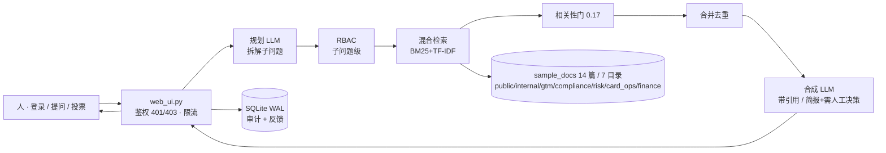

# Meridian Pay 知识大脑 (KB-QA Agent Platform)

> **Ask once. Every sub-question is permission-checked. Zero leaks — measured, not promised.**
> 一次提问，多跳拆解；每个子问题都过权限；零泄露不是架构声明，是 26 项红队攻击实测的数字。


腾讯云 AI CAN DO IT Hackathon 2026 · FinTech 赛道（Aspire 出题）
**Enterprise Agent Builder & Autonomous Operations Platform** — 演示场景 ② Internal Knowledge Brain

## 界面


## 是什么

一个参数化 Agent 工作流平台：同一套「规划 → 多子问题检索(各自过 RBAC) → 合并 → 合成」多跳骨架，
通过不同的规划/合成 prompt 驱动不同业务 agent：

- **knowledge_qa** 知识问答：LLM 拆解子问题 → 逐子问题检索 → 合并合成带引用答案
- **gtm_research** 账户情报：按 信号 / ICP 路由 / 套餐折扣 / 案例合规 四维拆解，
  输出结构化账户情报简报（评分卡 / 行业速查 / tier 联动跟进节奏 / 红线检查 /
  首触邮件草稿 / 节省工时估算 / 需人工决策清单）

## 核心能力

**检索与生成**

- 混合检索：BM25 + TF-IDF 向量，中英文混合分词（中文单字 + 二字 bigram）
- 绝对可比相关性门：`relevance = BM25 分 / 查询自匹配上界`，阈值 **0.17 由 27 组标注样本标定**
  （无关 ≤0.145 / 弱相关 ≤0.152 / 有答案 ≥0.244，三类完全分离）；无关提问干净判 no_context
- LLM 生成（OpenAI 兼容接口，可换任意模型）+ 抽取式离线回退 + 瞬时故障自动重试

**权限与安全**

- 身份认证（auth.py，纯标准库）：PBKDF2-HMAC-SHA256 口令哈希（200k 迭代 + 随机 salt）、
  HMAC 签名会话令牌（jti 登出吊销、角色变更即作废、恒定时间比较）、
  未知用户等开销哈希防账号枚举
- RBAC：目录级权限，**7 个岗位 × 7 个目录**——admin 全部；sales = public+gtm；
  viewer = public；compliance_officer = public+compliance；risk_analyst = public+compliance+risk；
  card_ops = public+card_ops；finance_analyst = public+finance
  **子问题层级生效**——越权子问题检索为空；角色只由服务端令牌签发，请求体声明无效
- 治理：/api/audit 与 /api/ask 身份只认 Bearer 令牌（无令牌 401 / 角色不足 403）

**审计与可观测**

- SQLite 全量问答审计（WAL 模式，并发安全）+ 反馈闭环（有用/无用投票入库）
- 审计抽屉聚合看板：总问答 / 模式分布 / 活跃用户 / 反馈数 / Top 文档
- 查询规划块（子问题可视化）、耗时、来源引用 + 平台徽章（Confluence/Drive/Jira，代码常量映射）
- no_context 设计化拒绝卡片：「证据不足 · 已拒绝回答」——宁可拒绝，不给没有依据的答案

## 架构与信任边界

LLM 在边缘（规划、合成），确定性代码在核心（鉴权、RBAC、检索、相关性门、审计）。
**LLM 无任何写路径，也永远看不到没过 RBAC 和相关性门的 chunk。** 完整版见
[`docs/architecture.md`](docs/architecture.md)。



> 演示语料 `sample_docs/` 为虚构 Meridian Pay（B2B fintech）数据，角色、文档与审计记录均为演示用途（honest simulation）。

## 评测（五套，115 断言 — 2026-10-13 全绿）

| 套件 | 用例 | 断言 | 结果 | 关键数字 |
|------|------|------|------|----------|
| test_rbac.py | 8 | 金标准：leak rate = 0 + recall 漏检 = 0（成对断言） | 8/8 ✅ | **leak rate = 0 · recall 漏检 = 0** |
| test_relevance.py | 21 | 无关必 no_context + 正样本必命中 + 分数可分性（0.17 标定） | 21/21 ✅ | 无关最高 0.1492 < 0.17 < 命中最低 0.2464（余量 1.14x / 1.45x） |
| test_auth.py | 23 | 认证攻击面：无令牌/伪造角色/篡改 payload/登出吊销/越权入口 | 23/23 ✅ | 23 攻击面用例全绿 |
| test_web_matrix.py | 37 | 18 组角色矩阵 + 审计权限 + agent 工作流用例 + **8 金融岗位用例**（合规/风控/卡运营/财务） | 37/37 ✅ | 全矩阵全绿 |
| test_redteam.py | 26 | **红队对抗**：语义改写 8 + 提示注入 4 + 路径逃逸 2 + 角色伪造 4 + 多跳拼图泄漏 3 + 阈值压制 2 + 反作弊回归 3 | 26/26 ✅ | **26 种攻击零泄漏**（报告见 [RED-TEAM-REPORT](docs/RED-TEAM-REPORT.md)） |

评测轴对齐行业框架：0 role violations、0 PII leaks、faithfulness 100%（0 幻觉引用）。

实测延迟（本机 → DeepSeek chat，12 次实测，2026-10-13）：**中位 1038ms · p90 1202ms**（全链路含 LLM 调用）。

## 构建方式（WorkBuddy）

主构建工具为 **WorkBuddy（腾讯云）**：9/26 试跑生成核心 `kb_qa.py`，会话①-⑤（10/8-10/13）依次构建
Web 界面、鉴权与相关性门标定、GTM 语料、账户情报 agent。会话 prompt 与对话记录在
[`docs/build-sessions/`](docs/build-sessions/)，12 张聊天截图在 [`证据/`](证据/)。
Claude Code 负责补丁合并、四套评测质量门与 UI 打磨——完整分工叙事见
[`docs/AI-COLLABORATION.md`](docs/AI-COLLABORATION.md)。

## 谁在用（persona）

| Persona（Aspire 业务语境） | 需求 | 我们的回答 |
|---|---|---|
| 合规/内审（alice · admin） | 全量可见 + 「谁问了什么、答了什么、基于哪篇文档」可追溯 | 审计抽屉 + SQLite 全量审计（MAS FEAT accountability 证据 + Notice 626 STR-readiness 文档） |
| 合规官（cara · compliance_officer） | 查 KYC/AML 政策、可疑交易上报时限、PDPA 要点 | compliance 目录（KYC 文件清单 / 监管检查清单） |
| 风控分析师（ray · risk_analyst） | 查交易监控阈值与频次规则 | compliance + risk 目录 |
| 卡运营（erin · card_ops） | 查企业卡发卡条件与卡片状态规则 | card_ops 目录；问合规内容被干净拦截 |
| 财务分析师（fay · finance_analyst） | 查支出管理政策与差旅标准 | finance 目录 |
| 销售/客户经理（sam · sales） | 快速拿折扣治理/案例/ICP 规则；碰薪酬等敏感数据被干净拦截 | 子问题级 RBAC：命中所属目录，越权拿 no_context |
| 新员工/外部协作者（bob · viewer） | 只读入职指南与报销 FAQ | 目录级白名单：public only |
| GTM 团队 | 单客户调研 2-3 小时 → 30 秒（brief 的 GTM Engineering workflow） | gtm_research 账户情报简报（评分卡/ICP 路由/首触邮件草稿/需人工决策清单） |

## 市面上有什么（what's out there）

| 现状 | 它们怎么做 | 我们的差异 |
|---|---|---|
| Onyx（32k★）企业搜索 | 连接 50+ 应用，RBAC 覆盖 web/API | 我们是 agent 平台不是搜索：多跳规划 + 工作流注册表；权限下探到**子问题级**——拆解后的查询也捞不出越权文档 |
| VaultRAG ACL 前置检索 | ACL 谓词进检索查询，越权 chunk 不进流程 | 同属 pre-retrieval 过滤（OWASP LLM08 推荐），另加**绝对可比相关性门**（0.17 标定）——能区分「内容存在但你没权限」和「内容不存在」 |
| RAGFlow / LightRAG 图谱编译 | 图索引增强多跳 | 我们选混合检索 + 标定门（同等召回、可测试性更强）；图谱编译列为 roadmap |
| 通用 RAG demo | 无权限概念，撞词就答 | 宁可 no_context，不给没有依据的答案（诚实拒绝卡） |

## 评审速览（For judges）

- **[需求映射表](docs/requirements-map.md)** — Aspire 出题每条要求 → 机制 → 文档 → 可见产物；
  10 个评审维度（10×10 分）→ 证据对照
- 提交要件：WorkBuddy 证明（会话①-⑤ + 12 张截图，[AI-COLLABORATION.md](docs/AI-COLLABORATION.md)）✅ · blurb 7 词 ✅ · 封面 16:9 380×216 ✅

### 30 秒体验路径（live demo）

> 线上地址：**`https://<your-app>.onrender.com`**（Render 部署后替换此行；本地体验用 `http://localhost:8000`）

| 步 | 操作 | 看到什么 |
|---|---|---|
| 1 | 打开地址，登录 `alice / meridian-demo`（admin） | 紫红 hero + 工作流选择器 + 合规徽章 |
| 2 | 问「薪酬带宽是多少？」 | 命中 internal/roadmap + 来源引用卡片 + 平台徽章 + 规划块 |
| 3 | 登出，登录 `sam / meridian-demo`（sales），问**同一问题** | 干净 no_context 拒绝卡（RBAC 拦截特写，全片 wow moment） |
| 4 | 问「大客户报价折扣能批到几折？」 | 命中 gtm/pricing（sales 权限内） |
| 5 | 切到「账户情报」工作流，问「计划拓展东南亚，帮我做账户情报分析并给路由建议」 | 规划块拆解 4 个子问题（每个独立过 RBAC）→ 评分卡 / ICP 路由 / 首触邮件草稿 / 需人工决策清单 |
| 6 | 登回 alice，打开审计抽屉 | 全量留痕：谁问了什么、被拦了什么、基于哪篇文档 |
| 7 | 进阶：登录 `cara`（合规官）问「可疑交易上报的时限是多少？」→ 命中合规文档；换 `erin`（卡运营）同问 → 拦截 | 金融岗位 × 目录权限矩阵的第二个对比镜头 |

也可一条命令重放全部 8 个场景并截图：`KB_DEMO_URL=<你的URL> python3 screenshot_demo.py`

## 运行

```bash
pip install -r requirements.txt
python3 web_ui.py          # http://localhost:8000
```

演示账号（统一口令 `meridian-demo`）：

- `alice`(admin 全量) · `sam`(sales) · `bob`(viewer)
- `cara`(compliance_officer 合规) · `ray`(risk_analyst 风控) · `erin`(card_ops 卡运营) · `fay`(finance_analyst 财务)

LLM 模式（OpenAI 兼容接口，无 Key 自动回退抽取式）：

```bash
LLM_BASE_URL=https://api.deepseek.com LLM_API_KEY=sk-xxx LLM_MODEL=deepseek-chat \
KB_AUTH_SECRET=$(openssl rand -hex 24) python3 web_ui.py
```

> 未设 `KB_AUTH_SECRET` 时签名密钥为进程随机生成（重启全员登出，仅本地调试用）；
> `KB_AUTH_MODE=anonymous` 可关闭鉴权（仅限本地演示）。

## API

- `POST /api/login` `{username, password}` → token（服务端 HMAC 签发，8h 有效）
- `POST /api/logout` → 令牌吊销
- `POST /api/ask` `Authorization: Bearer <token>` `{question, agent, workflow}` → answer/mode/sources/sub_queries/elapsed_ms
- `GET /api/audit?limit=20` → 审计日志 + 聚合看板（仅 admin）
- `POST /api/feedback` `{question, vote: 1|-1}` → 反馈入库（运营闭环）
- `GET /api/health` → 索引状态 + 可用工作流 + 鉴权模式

## 部署 (Render)

`render.yaml` Blueprint 一键部署。Dashboard 补两个环境变量：`LLM_API_KEY`、`KB_AUTH_SECRET`
（均为 sync: false，不入仓库）。免费档 15 分钟无访问会休眠，用 UptimeRobot 每 10 分钟
ping `/api/health` 保活。**免费层冷启动约 20-60 秒**：评委首访前请自行预热一次（部署后
用无痕窗口点开计时确认）。

## 目录

```
kb_qa.py            主系统（摄入/混合检索/相关性门/RBAC/审计/多跳 agent/工作流注册表）
web_ui.py           Web 服务（标准库 http.server，鉴权接入，0.0.0.0 + PORT）
auth.py             身份认证（PBKDF2 口令 + HMAC 令牌 + 吊销）
static/index.html   聊天界面（登录/工作流选择器/规划块/平台徽章/审计看板/反馈）
test_rbac.py        金标准评测（leak=0 + recall=100%）
test_relevance.py   相关性门标定评测（21 用例）
test_auth.py        认证攻击面评测（23 用例，自起服务）
test_web_matrix.py  Web 层矩阵（37 用例，含 8 个金融岗位矩阵）
test_redteam.py     红队对抗套件（26 项攻击检查，零泄漏；跑前服务需以 KB_LOGIN_RATE_LIMIT=200 启动）
docs/requirements-map.md  需求映射表（Aspire brief → 机制 → 证据 + 评审维度对照）
docs/architecture.md  架构与信任边界（mermaid 流水线 + 三区职责表）
docs/RED-TEAM-REPORT.md  红队报告（攻击矩阵 + 每组的"为什么"）
docs/UX-ACCESSIBILITY-AUDIT.md  无障碍审计（WCAG 2.2 AA 对比度实测 + 已应用修复）
docs/AI-COLLABORATION.md  AI 协作分工叙事（WorkBuddy 主构建 + Claude Code 合并验证）
docs/build-sessions/  WorkBuddy 会话①-⑤ prompt 全文 + 9/26 试跑对话记录
scripts/demo_path.py  demo 路径 e2e 证明（三角色命中/拦截/审计/401/403）
.github/workflows/  CI：每次 push 跑五套 115 断言（无需 LLM key）
证据/               WorkBuddy 聊天截图 12 张 + 本机演示截图 8 张 + 封面图
sample_docs/        Meridian Pay 语料 14 篇（public/internal/gtm/compliance/risk/card_ops/finance，虚构数据）
```
