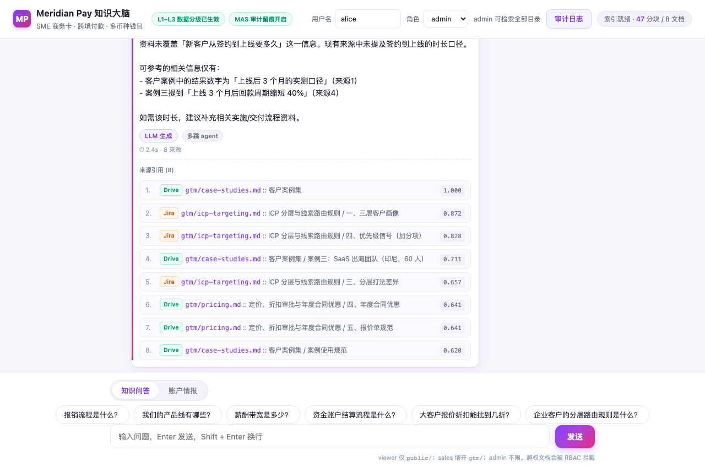
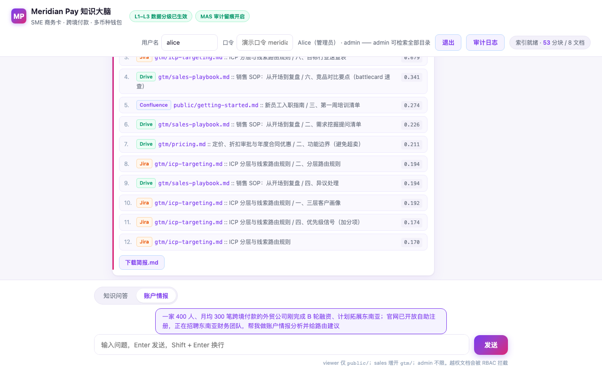
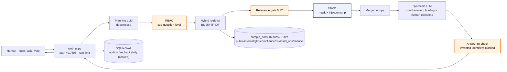

# Meridian Pay Knowledge Brain (KB-QA Agent Platform)

[中文版 / 中文版](README.zh-CN.md)

**🔴 Live: [meridian-pay-kb.onrender.com](https://meridian-pay-kb.onrender.com)** ·
demo account `alice` / password `meridian-demo` · **one-click judge walkthrough (six auto-steps): [`?demo=1`](https://meridian-pay-kb.onrender.com/?demo=1)**

**📹 Demo video (5:57): [https://youtu.be/b3Z1RCmMRmI](https://youtu.be/b3Z1RCmMRmI)** — FinTech case-study declaration, sub-question RBAC, disclosure gate, shield, audit chain, evaluation

> **Ask once. Every sub-question is permission-checked. Every identifier masked. Zero leaks — measured, not promised.**
> One question, decomposed into sub-questions; each passes RBAC and sensitive identifiers are masked before they reach the model. Zero leaks is not an architectural claim — it is a number from 26 adversarial red-team attacks.


Tencent Cloud AI CAN DO IT Hackathon 2026 · FinTech Track (challenge by Aspire)
**FinTech Track (Aspire) — challenge: "The Internal Brain: A Context-Aware Enterprise Knowledge System with RBAC, Security Logging & Audit Trail"**

**Built solo** — one developer, one AI assistant, no teammates. 337 assertions, ten suites, one coherent codebase.

## Interface





## What it is

A parameterised agent-workflow platform: one multi-hop skeleton — *plan → retrieve each sub-question (each passing RBAC) → merge → synthesise* — drives different business agents through different plan/synthesis prompts:

- **knowledge_qa** — knowledge Q&A: the LLM decomposes the question → per-sub-question retrieval → merged, cited answer
- **gtm_research** — account intelligence: decomposition across signals / ICP routing / package discounts / case-law compliance, producing a structured briefing (**deterministic scorecard** / industry cheatsheet / tier-linked follow-up cadence / red-line check / **deterministic first-touch email draft** / hours-saved estimate / human-decisions list)
  — scorecard and email draft are computed by code, so **the six-section briefing is complete even with no LLM key configured**

## Core capabilities

**Retrieval & generation**

- Hybrid retrieval: BM25 + TF-IDF with mixed CN/EN tokenisation (single char + bigram)
- Absolute relevance gate: `relevance = BM25 score / query self-match ceiling`, threshold **0.17 calibrated on 27 labelled samples** (measured: irrelevant/weak max 0.1521 < 0.17 < relevant min 0.2580 — three classes fully separated, 1.12x / 1.52x margin; numbers drift with the corpus, `python3 test_relevance.py` recomputes them); off-topic questions get a clean `no_context`
- LLM generation (OpenAI-compatible API, any model) + extractive offline fallback + auto-retry on transient faults

**Permissions & security**

- Authentication (`auth.py`, stdlib only): PBKDF2-HMAC-SHA256 password hashing (200k iterations + random salt), HMAC-signed session tokens (jti logout revocation, role change invalidates, constant-time compare), dummy-hash for unknown users to prevent account enumeration
- RBAC: directory-level permissions, **7 roles × 7 directories** — admin: all; sales: public+gtm; viewer: public; compliance_officer: public+compliance; risk_analyst: public+compliance+risk; card_ops: public+card_ops; finance_analyst: public+finance. **Enforced at the sub-question level** — as a permission gate, not an answer layout: an out-of-scope sub-question retrieves nothing; roles come only from server-issued tokens, never from the request body
- Governance: `/api/audit` and `/api/ask` trust only the Bearer token (401 without, 403 with insufficient role)

**Shield (third gate · `shield.py`)**

The first two gates leave two leak classes uncovered; the shield closes them and **only narrows, never widens**:

- **Need-to-know masking**: permission to read a document ≠ need to see every card number in it. Card numbers / NRIC / FIN / IBAN / bank accounts / phone / email / birth dates / passports / Singapore addresses / credentials (credentials masked even for admin) are masked **before the LLM sees them**. Validation, not length guessing: cards must pass Luhn, IBANs mod-97 — a 16-digit serial that fails Luhn is not masked, an IBAN-shaped number that fails the checksum is not flagged
- **Prompt-injection pre-scan**: documents are data, not instructions (OWASP LLM01). Whole lines like "ignore all previous instructions", "SYSTEM: new rule", "Note to AI assistants" are removed (CN & EN), forged `[来源N]` labels neutralised (context boundaries cannot be faked), zero-width/hidden characters stripped
- **Answer re-check**: the generated answer is scanned again — a card number the model invents is caught; numbers the user typed themselves are kept
- **The audit trail is not a second leak surface**: questions and answers are stored fully masked — rules and counts only, never plaintext

**Deterministic scorecard (GTM · `scorecard.py`)**

A sales scorecard that returns different scores on two runs, with no traceable provenance per point, conflicts directly with auditability. So the four GTM dimensions are graded **by code against the existing rules in `gtm/icp-targeting.md` §6**, not by the model; the LLM is demoted to narrator:

- **Fit / Timing / Access / Intent, 0-25 each, total 100 → tier**: every point traces to a specific clause (e.g. "Series B+ funding → 20-25", "+8 per access path hit")
- **Same input, same score, always**: no randomness, no time dependence, no network calls (4 of the 56 assertions pin exactly this)
- **Red lines override any score**: hitting the do-not-pursue list (crypto / online gambling / sanctions / shell entities…) → tier = do-not-pursue even with a perfect score — the score is kept as evidence, routing must terminate
- **Missing facts ≠ do-not-pursue**: missing dimensions score 0 and are marked "needs human input" — no sympathy points; and "complete facts, genuinely low score → do-not-pursue" is distinguished from "incomplete facts → collect more". With partial facts, the score is declared a **lower bound**

**Audit & observability**

- Full SQLite Q&A audit (WAL mode, concurrency-safe) + feedback loop (helpful/unhelpful votes persisted)
- Data freshness: `POST /api/resync` (admin) on demand + `KB_RESYNC_MINUTES` bounded resync window (minute-level) + citations carry the document's "updated at" mtime — stale content is never served silently
- Audit drawer aggregate dashboard: total Q&As / mode distribution / active users / feedback count / top documents
- Query planning block (sub-question visualisation), latency, source citations + platform badges (Confluence/Drive/Jira, code-constant mapping)
- Designed no-context rejection card: "证据不足 · 已拒绝回答" — refuse rather than answer without evidence

## Architecture & trust boundaries

The LLM sits at the edges (planning, synthesis); deterministic code sits at the core (auth, RBAC, retrieval, relevance gate, audit). **The LLM has no write path, and never sees a chunk that failed RBAC or the relevance gate.** Full version in [`docs/architecture.md`](docs/architecture.md).



Responsibilities of the three gates (all deterministic code; the LLM never participates in the verdict):

| Gate | Answers | Does not answer |
|---|---|---|
| RBAC (sub-question level) | May this person see this document | Whether they need the card numbers inside it |
| Disclosure gate (audience) | May this sentence be said in front of a customer | Whether a line of text can order the model around |
| Shield (need-to-know + injection) | Mask this identifier? Is this line an instruction? | Who has permission (that is RBAC's job) |

> The demo corpus `sample_docs/` is fictional Meridian Pay (B2B fintech) data; roles, documents and audit records are for demonstration (honest simulation).

## Evaluation (10 suites, 337 assertions — all green 2026-10-15)

| Suite | Cases | What it pins | Result | Key numbers |
|------|------|------|------|----------|
| test_rbac.py | 8 | Gold standard: leak rate = 0 + recall loss = 0 (paired assertions) | 8/8 ✅ | **leak rate = 0 · recall loss = 0** |
| test_relevance.py | 21 | Irrelevant must no_context + positives must hit + score separability (0.17 calibration) | 21/21 ✅ | Irrelevant max 0.1521 < 0.17 < relevant min 0.2580 (1.12x / 1.52x margin) |
| test_auth.py | 23 | Auth attack surface: no token / forged role / tampered payload / logout revocation / unauthorised entry | 23/23 ✅ | 23 attack-surface cases green |
| test_web_matrix.py | 49 | 18 role-matrix pairs + audit permissions + agent workflow cases + **8 fintech role cases** + **5 data-freshness cases** + audit-chain verify permissions + **5 demo-mode cases** (`?demo=1` is not a bypass) | 49/49 ✅ | Full matrix green |
| test_redteam.py | 26 | **Red team**: semantic rewrites 8 + prompt injection 4 + path escape 2 + role forgery 4 + multi-hop puzzle leaks 3 + threshold suppression 2 + anti-cheat regression 3 | 26/26 ✅ | **26 attacks, zero leaks** (report: [RED-TEAM-REPORT](docs/RED-TEAM-REPORT.md)) |
| test_audit_chain.py | 6 | **Tamper evidence**: append-only triggers block UPDATE/DELETE + SHA-256 chain recomputation locates the tampered row + legacy-db migration backfill | 6/6 ✅ | Tampering is always located (capability ⑥ worked example) |
| test_disclosure.py | 11 | **Customer-present disclosure gate**: zero leakage to external context + zero over-blocking of disclosable content + only narrows + sub-question level in multi-hop | 11/11 ✅ | Same question: 4 internal docs → only case-studies with customer present |
| test_shield.py | 32 | **Shield**: masking correctness 10 (incl. reverse assertions "a 16-digit number failing Luhn must NOT be masked", "an IBAN failing the checksum must NOT be masked") + injection scan 7 (CN/EN injection / forged labels / zero-width + **normal business text must not be deleted**) + end-to-end 15 | 32/32 ✅ | 8 identifier classes fully masked, 2 injection lines removed, business conclusions intact |
| test_gtm_scorecard.py | 56 | **Scorecard determinism**: reproducibility 4 (5 runs must agree) + rule correctness 13 (each tier traces to icp-targeting.md §6) + red-line priority 8 + **missing facts not misjudged as do-not-pursue** 8 + traceable rationale 12 + routing linkage 4 + input robustness 4 | 56/56 ✅ | Same input: score / tier / rendered text identical across 5 runs |
| test_gtm_outreach.py | 105 | **Email draft determinism**: reproducibility 4 + structure 26 (subject ≤8 English words / 3-4 sentence body / four compliance notes) + **slots actually filled** 14 (tier changes CTA, industry changes value prop & case, strongest signal changes opener) + boundaries 13 (red line produces no copy / insufficient facts get a checklist / partial facts still draft) + banned-word scan 3 + **no invented numbers** 4 + scorecard linkage 10 + robustness 6 + offline integration 11 | 105/105 ✅ | Every number in the body traces to a template constant or user-supplied fact |

Evaluation axes aligned with industry frameworks: 0 role violations, 0 PII leaks, faithfulness 100% (0 hallucinated citations).

Why the scorecard gets its own suite: correctness-only tests would be passed by an implementation that judges every uncertain input "do-not-pursue" — that is caution disguised as safety. Group D asserts "missing facts ≠ do-not-pursue"; group C constructs a "perfect score but red-line" input to force red-line priority.

Why the email draft gets its own suite: structure-only tests would be passed by a template that sends every customer the same email with the name swapped — that is a template disguised as personalisation. Group C asserts tier / industry / strongest signal each change the output; group F asserts every number traces to a constant or a fact; group D asserts that a sanctioned entity gets **not a single word**.

Why the demo mode (`?demo=1`) gets its own tests too: it is the easiest place for an auth bypass to hide — "it's for the judges" is the most legitimate-sounding reason to skip a login. D1 asserts `/` and `/?demo=1` return the **same HTML** (the server has no demo-mode branch), D3 asserts tokenless asks are still 401, and D4/D5 pin the two most critical scripted moments (sales asking the same question must be blocked; customer-present must leave only case-studies) — so what judges see live cannot drift from the script.

> **Paired assertions** are a hard requirement: a test that only checks "card numbers are masked" would be passed by an implementation that masks every number; it must also check "a 16-digit number failing Luhn is not masked" and "normal business text is not deleted" to prove precision rather than brute-force obscuring.

Measured latency (local → DeepSeek chat, 12 runs, 2026-10-13): **median 1038ms · p90 1202ms** (end-to-end including the LLM call).

## How it was built (WorkBuddy)

Primary build tool is **WorkBuddy (Tencent Cloud)**: the 9/26 foundation run produced the core `kb_qa.py`; sessions ①–⑤ (10/8–10/13) built the web UI, auth and relevance-gate calibration, GTM corpus, and the account-intelligence agent in sequence. Session prompts and transcripts are in [`docs/build-sessions/`](docs/build-sessions/); 12 chat screenshots are in [`证据/`](证据/). Claude Code handled patch merging, the evaluation quality gates and UI polish — the full division of labour is in [`docs/AI-COLLABORATION.md`](docs/AI-COLLABORATION.md).

## Personas

| Persona (Aspire business context) | Need | Our answer |
|---|---|---|
| Compliance / internal audit (alice · admin) | Full visibility + "who asked what, answered what, based on which document" — traceable and **tamper-evident** | Audit drawer + full SQLite audit + **SHA-256 hash chain (append-only, one-click re-verification)** (MAS FEAT accountability evidence + Notice 626 STR-readiness documentation) |
| Compliance officer (cara) | KYC/AML policies, STR reporting deadlines, PDPA essentials | compliance directory |
| Risk analyst (ray) | Transaction-monitoring thresholds and frequency rules | compliance + risk directories |
| Card ops (erin) | Corporate card issuance conditions and card-status rules | card_ops directory; compliance questions are cleanly blocked |
| Finance analyst (fay) | Spend-management policy and travel standards | finance directory |
| Sales / account manager (sam) | Discount governance / case studies / ICP rules fast; salary data cleanly blocked | Sub-question RBAC: hits allowed directories, gets no_context on out-of-scope |
| New hire / external collaborator (bob) | Onboarding guide and expense FAQ, read-only | Whitelist: public only |
| GTM team | 2–3 hours of manual research per account → 30 seconds (the brief's GTM Engineering workflow) | gtm_research account-intelligence briefing (scorecard / ICP routing / first-touch email draft / human-decisions list) |

## What's out there

| Current state | How they do it | Our difference |
|---|---|---|
| Onyx (32k★) enterprise search | 50+ connectors, RBAC across web/API | We are an agent platform, not search: multi-hop planning + workflow registry; permissions go down to the **sub-question level** — a decomposed query cannot fish out restricted documents |
| VaultRAG ACL-prefixed retrieval | ACL predicates enter the retrieval query; out-of-scope chunks never enter the pipeline | Also pre-retrieval filtering (OWASP LLM08 recommended), plus an **absolute, comparable relevance gate** (0.17 calibrated) — able to distinguish "content exists but you lack permission" from "content does not exist" |
| RAGFlow / LightRAG graph compilation | Graph-indexed multi-hop | We chose hybrid retrieval + a calibrated gate (equal recall, stronger testability); graph compilation is roadmap |
| Generic RAG demos | No permission concept; answers on keyword collisions | Rather no_context than an answer without evidence (designed refusal card) |
| PII handling in enterprise RAG | Mostly "filter after the model answers", or nothing | Masking happens **before the LLM sees the context**, and the answer is **re-checked** after generation; the audit store itself is fully masked — it does not become a second leak surface |

## For judges

### The brief's 7 hard requirements → completion (Handbook §2)

> Line-by-line against the Aspire brief. **5 of 7 fully implemented, 2 partially** — boundaries stated proactively, because for a licensed financial institution's reviewers, saying clearly what is not done is itself part of Responsible AI.

| # | Official requirement | Status | Mechanism | Boundary / how far it goes |
|---|---|---|---|---|
| 1 | Unified natural-language query, single cited answer | ✅ Full | Multi-hop plan → per-sub-question retrieval → merge & synthesise; every source carries path / platform / score | — |
| 2 | Permission-aware retrieval: filter **before** the LLM, never flatten platform permission models | ⚠️ **Partial** | Filter position is correct: pre-retrieval ACL enforced at retrieval time, at the **sub-question level** (finer than document-level); gold standard leak = 0 | Filtering is implemented and measured at leak=0, but connectors are slots — **not verified end-to-end against a real platform permission model** (see "About the demo corpus" below) |
| 3 | Data freshness: bounded window (minutes ~ 1 hour), never serve stale content silently | ✅ Full | `POST /api/resync` on demand + `KB_RESYNC_MINUTES` scheduled window; citations carry document mtime | — |
| 4 | Negative permission cases: refusal must not leak that restricted content **exists** | ✅ Full | Out-of-scope sub-question retrieves nothing → `no_context` card; in external context, internal docs appear in neither answer nor source list — no metadata side channel | — |
| 5 | Live permission changes take effect on subsequent queries | ⚠️ **Partial** | Token embeds the role and is re-checked against the account's current role (role change → old token immediately 401); 23 auth attack-surface cases cover this | **Role** changes are immediate ✅; **document-level** permission changes rely on the resync window — no per-query source-of-truth check |
| 6 | Audit queries: tamper-evident, complete, queryable; a compliance officer can reconstruct | ✅ Full | SQLite WAL full audit + append-only triggers + SHA-256 hash chain (recomputation locates the tampered row); admin-only API + aggregate dashboard | — |
| 7 | LLM leak mitigation: reduce hallucination and fabrication | ✅ Full | Answers grounded only in gated sources (0 hallucinated citations); no source → refusal; **answer re-check** — a card number the model invents is caught post-generation | — |

**About the demo corpus (the explanation for #2's "partial")**: the corpus is 16 local Markdown files; platform badges carry `·demo` and the API returns `demo_corpus: true`. This is a **deliberate scope choice, not an unfinished feature in disguise** — verification effort is concentrated on the formal invariants of permissions and audit (provable repeatedly by 337 assertions in CI) rather than on connector implementation. Swapping in real Confluence / Jira connectors requires no change to any gate, test or invariant.

**Beyond the official 7** (Aspire is a licensed financial institution; PII is a hard requirement the handbook does not list separately): need-to-know minimisation (masking **before** the LLM, Luhn / mod-97 validation rather than length guessing) · indirect prompt-injection defence (OWASP LLM01) · fully masked audit storage that does not become a second leak surface.

- **[Requirements map](docs/requirements-map.md)** — every Aspire brief requirement → mechanism → document → visible artifact; 10 judging dimensions (10×10) → evidence mapping
- **[Key design trade-offs](docs/DECISIONS.md)** — six decisions, each stating what was chosen / what was rejected / **the cost** / which tests pin it (including the measured counter-example for why OOV words must count toward the BM25 ceiling)
- **[Self-verification checklist](docs/SELF-VERIFICATION.md)** — three-minute browser version + ten-minute CLI version; `python3 scripts/verify.py` re-proves 37 claims (every public statement in the README), `--full` additionally runs all ten suites (337 assertions)
- Submission items: WorkBuddy proof (sessions ①–⑤ + 12 screenshots, [AI-COLLABORATION.md](docs/AI-COLLABORATION.md)) ✅ · 8-word blurb (repo-wide: `Ask anything. RBAC decides. Shield masks. You audit.`) ✅ · 16:9 cover 380×216 ✅ · demo video (5:57, English narration + subtitles): [https://youtu.be/b3Z1RCmMRmI](https://youtu.be/b3Z1RCmMRmI) ✅

### 30-second experience path (live demo)

> Live: **https://meridian-pay-kb.onrender.com** (measured sub-second response after 16 minutes idle; local: `http://localhost:8000`)
>
> **In a hurry, just open [`?demo=1`](https://meridian-pay-kb.onrender.com/?demo=1)**: a demo bar appears at the top; clicking "next" switches accounts, switches workflows and asks the questions itself — six steps covering RBAC interception, account intelligence and the customer-present disclosure gate. It only pre-fills the password and guides in order; **every step goes through the real `/api/login` + `/api/ask`**, so the `no_context` sales sees in that step is genuinely blocked server-side, not staged in the frontend (`test_web_matrix.py` D1–D5 pin this).

| Step | Action | What you see |
|---|---|---|
| 1 | Open the URL, log in `alice / meridian-demo` (admin) | Purple-red hero + workflow selector + compliance badges |
| 2 | Ask 「薪酬带宽是多少？」("What are the salary bands?") | Hits internal/roadmap + source citation cards + platform badges + planning block |
| 3 | Log out, log in `sam / meridian-demo` (sales), ask **the same question** | Clean no_context rejection card (RBAC interception close-up — the wow moment) |
| 4 | Ask 「大客户报价折扣能批到几折？」("How much discount can be approved for key accounts?") | Hits gtm/pricing (within sales permissions) |
| 5 | Switch to the 「账户情报」 workflow, ask 「计划拓展东南亚，帮我做账户情报分析并给路由建议」 | Planning block decomposes 4 sub-questions (each passing RBAC independently) → scorecard (signal library) / ICP routing / LAARC objection playbook / first-touch email draft / human-decisions list |
| 6 | With sam, toggle 「客户在场（披露门）」 (customer present) and ask 「客户问我们有没有同类案例，以及能给多少折扣」 | **Same question: 4 doc sources → only case-studies (green "disclosable" badge)**; amber banner + the planning block shows each sub-question passing the gate — internal pricing / objection scripts are blocked by the disclosure gate |
| 7 | Back to alice, open the audit drawer, click 「验证链」 | Full trail: who asked what, what was blocked, based on which document; SHA-256 hash chain re-verified in one click |
| 8 | Advanced: log in `cara` (compliance) and ask 「可疑交易上报的时限是多少？」 → hits compliance docs; switch to `erin` (card ops), same question → blocked | Second contrast shot: fintech role × directory permission matrix |
| 9 | Advanced: edit any `sample_docs/` document, log in `alice` and `POST /api/resync`, ask the same question again | New content is answerable; citation card shows "updated HH:MM" — the official "data freshness" worked example |
| 10 | **Shield**: `python3 scripts/demo_shield.py` | One dispute record containing PII and injection, three-way contrast: shield off (model sees plaintext card numbers + injected instructions) → shield on (8 identifier classes become tags, 2 injection lines removed, business conclusions intact) → answer re-check (a card number the model invents is caught). The script carries 8 self-checks so it cannot silently break after code changes |

Replay steps 1–9 with screenshots in one command (step 10 is a local script): `KB_DEMO_URL=<your-URL> python3 screenshot_demo.py`

> Step 10 uses the separate corpus directory `demo_docs/` (outside `sample_docs/`), so it does not touch the 27-sample relevance-gate calibration or any evaluation suite.

## Run

```bash
pip install -r requirements.txt
python3 web_ui.py          # http://localhost:8000
```

Demo accounts (shared password `meridian-demo`):

- `alice` (admin, full) · `sam` (sales) · `bob` (viewer)
- `cara` (compliance_officer) · `ray` (risk_analyst) · `erin` (card_ops) · `fay` (finance_analyst)

LLM mode (OpenAI-compatible API; falls back to extractive mode without a key):

```bash
LLM_BASE_URL=https://api.deepseek.com LLM_API_KEY=sk-xxx LLM_MODEL=deepseek-chat \
KB_AUTH_SECRET=$(openssl rand -hex 24) python3 web_ui.py
```

> Without `KB_AUTH_SECRET` the signing key is randomly generated per process (everyone logged out on restart; local debugging only); `KB_AUTH_MODE=anonymous` disables auth (local demos only).

## API

- `POST /api/login` `{username, password}` → token (server HMAC-signed, 8h validity)
- `POST /api/logout` → token revocation
- `POST /api/ask` `Authorization: Bearer <token>` `{question, agent, workflow}` → answer/mode/sources/sub_queries/elapsed_ms
- `GET /api/audit?limit=20` → audit log + aggregate dashboard (admin only)
- `POST /api/feedback` `{question, vote: 1|-1}` → feedback persisted (ops loop)
- `GET /api/health` → index status + available workflows + auth mode

## Deploy (Render)

`render.yaml` Blueprint, one-click. Fill two environment variables in the dashboard: `LLM_API_KEY`, `KB_AUTH_SECRET` (both `sync: false`, never in the repo). Deployed at **https://meridian-pay-kb.onrender.com** (measured sub-second response after 16 minutes idle on the free tier — no warm-up needed).

## Layout

```
kb_qa.py            main system (ingest / hybrid retrieval / relevance gate / RBAC / audit / multi-hop agent / workflow registry)
shield.py           shield (need-to-know masking + prompt-injection pre-scan + answer re-check)
scorecard.py        GTM deterministic scorecard (Fit/Timing/Access/Intent → tier; red-line priority; missing facts not misjudged)
web_ui.py           web service (stdlib http.server, auth wired in, 0.0.0.0 + PORT)
auth.py             authentication (PBKDF2 passwords + HMAC tokens + revocation)
static/index.html   chat UI (login / workflow selector / planning block / platform badges / audit dashboard / feedback)
test_rbac.py        gold standard (leak=0 + recall loss=0)
test_relevance.py   relevance-gate calibration (21 cases)
test_auth.py        auth attack surface (23 cases, self-hosted service)
test_web_matrix.py  web-layer matrix (49 cases: 8 fintech roles + 5 data-freshness + 5 demo-mode + audit-chain verify permissions)
test_audit_chain.py audit hash chain (append-only triggers + chain recomputation locates tampering)
test_disclosure.py  customer-present disclosure gate (audience tiers: zero leak + zero over-blocking)
test_shield.py      shield suite (masking + injection scan + answer re-check, 32 assertions, incl. reverse assertions)
test_gtm_scorecard.py  scorecard suite (reproducibility + rule correctness + red-line priority + missing-fact handling, 56 assertions)
test_redteam.py     red-team suite (26 attack checks, zero leaks; start the service with KB_LOGIN_RATE_LIMIT=200 before running)
docs/requirements-map.md  requirements map (Aspire brief → mechanism → evidence + judging dimensions)
docs/DECISIONS.md   key design trade-offs (six decisions, each with the cost it accepts)
docs/architecture.md  architecture & trust boundaries (mermaid pipeline + three-zone responsibility table)
docs/RED-TEAM-REPORT.md  red-team report (attack matrix + the "why" of each group)
docs/UX-ACCESSIBILITY-AUDIT.md  accessibility audit (WCAG 2.2 AA contrast measurements + applied fixes)
docs/AI-COLLABORATION.md  AI collaboration narrative (WorkBuddy primary builder + Claude Code merge & verification)
docs/build-sessions/  WorkBuddy sessions ①–⑤ full prompts + 9/26 foundation-run transcript
scripts/demo_path.py  demo path e2e proof (three roles: hit/block/audit/401/403)
scripts/demo_shield.py  shield contrast demo (off/on + answer re-check, 8 self-checks)
scripts/verify.py   self-verifier (37-item quick check + --full runs ten suites; checks that documented claims still hold)
.github/workflows/  CI: ten suites + self-verifier on every push (no LLM key needed)
证据/               WorkBuddy chat screenshots ×12 + local demo screenshots ×9 + cover image
sample_docs/        Meridian Pay corpus ×16 (public/internal/gtm/compliance/risk/card_ops/finance; gtm includes LAARC objection playbook + signal library; fictional data)
demo_docs/          shield demo corpus (dispute record with PII and injection), separate directory, excluded from calibration
```

## Known boundaries (honest)

Shortcomings we do not hide — there is an answer if a judge asks:

- **Demo corpus**: 16 fictional Markdown files; platform badges show Confluence/Drive/Jira but are **code-constant mappings, not live connectors** — hence the `·demo` suffix on every badge and `demo_corpus: true` from `/api/health`. Connectors are genuinely designed slots (unified ingest contract + platform constant table), but the data-source layer is not wired to real platforms.
- **Lexical retrieval only**: BM25 + TF-IDF, no embeddings / cross-encoder. Synonym rewrites rely on `QUERY_SYNONYMS`; proper nouns and function words in long queries can depress the relevance score (more visible on small corpora). The production path is a cross-encoder rerank — see the measured trade-off in the `self_ceiling()` comments.
- **The shield is rules, not a model**: injections rewritten to avoid the scan wordlists can bypass it; the remaining defences are "LLM has no write path + answer re-check + audit trail". Name detection covers annotated/titled names only, not street names.
- **Masking granularity**: Singapore formats (NRIC/FIN/mobile/postal codes) first; other jurisdictions covered by the generic passport/IBAN rules.
