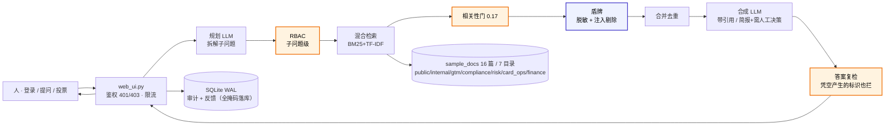

# Meridian Pay 知识大脑 (KB-QA Agent Platform)

> **Ask once. Every sub-question is permission-checked. Every identifier masked. Zero leaks — measured, not promised.**
> 一次提问，多跳拆解；每个子问题都过权限、敏感标识进模型前逐条脱敏；零泄露不是架构声明，是 26 项红队攻击实测的数字。

**🔴 线上可点开：[meridian-pay-kb.onrender.com](https://meridian-pay-kb.onrender.com)** ·
演示账号 `alice` / 口令 `meridian-demo` · **评委一键演示（六步自动走完）：[`?demo=1`](https://meridian-pay-kb.onrender.com/?demo=1)**


腾讯云 AI CAN DO IT Hackathon 2026 · FinTech 赛道（Aspire 出题）
**Enterprise Agent Builder & Autonomous Operations Platform** — 演示场景 ② Internal Knowledge Brain

## 界面


## 是什么

一个参数化 Agent 工作流平台：同一套「规划 → 多子问题检索(各自过 RBAC) → 合并 → 合成」多跳骨架，
通过不同的规划/合成 prompt 驱动不同业务 agent：

- **knowledge_qa** 知识问答：LLM 拆解子问题 → 逐子问题检索 → 合并合成带引用答案
- **gtm_research** 账户情报：按 信号 / ICP 路由 / 套餐折扣 / 案例合规 四维拆解，
  输出结构化账户情报简报（**确定性评分卡** / 行业速查 / tier 联动跟进节奏 / 红线检查 /
  **确定性首触邮件草稿** / 节省工时估算 / 需人工决策清单）
  —— 评分卡与邮件草稿都由代码算出，**没配 LLM key 时六节简报照样完整**

## 核心能力

**检索与生成**

- 混合检索：BM25 + TF-IDF 向量，中英文混合分词（中文单字 + 二字 bigram）
- 绝对可比相关性门：`relevance = BM25 分 / 查询自匹配上界`，阈值 **0.17 由 27 组标注样本标定**
  （实测：无关/弱相关最高 0.1521 < 0.17 < 应命中最低 0.2580，三类完全分离，
  余量 1.12x / 1.52x —— 数字随语料变化，`python3 test_relevance.py` 可随时重算）；
  无关提问干净判 no_context
- LLM 生成（OpenAI 兼容接口，可换任意模型）+ 抽取式离线回退 + 瞬时故障自动重试

**权限与安全**

- 身份认证（auth.py，纯标准库）：PBKDF2-HMAC-SHA256 口令哈希（200k 迭代 + 随机 salt）、
  HMAC 签名会话令牌（jti 登出吊销、角色变更即作废、恒定时间比较）、
  未知用户等开销哈希防账号枚举
- RBAC：目录级权限，**7 个岗位 × 7 个目录**——admin 全部；sales = public+gtm；
  viewer = public；compliance_officer = public+compliance；risk_analyst = public+compliance+risk；
  card_ops = public+card_ops；finance_analyst = public+finance
  **子问题层级生效**——越权子问题检索为空；角色只由服务端令牌签发，请求体声明无效
- 治理：/api/audit 与 /api/ask 身份只认 Bearer 令牌（无令牌 401 / 角色不足 403）

**盾牌（第三道闸 · `shield.py`）**

前两道门都不覆盖两类泄露，盾牌补上，且**只收窄、从不放宽**：

- **need-to-know 脱敏**：你能看这份文档 ≠ 你需要看到里面那位客户的卡号。
  进 LLM 前掩码卡号 / NRIC / FIN / IBAN / 银行账号 / 手机 / 邮箱 / 出生日期 /
  护照 / 新加坡地址 / 凭证（凭证对 admin 也掩码）。
  靠**校验而非猜长度**：卡号过 Luhn、IBAN 过 mod-97，所以「16 位但 Luhn 不过的
  流水号」不会被误杀，而「形似 IBAN 但校验不过的编号」也不被误报。
- **提示注入前置扫描**：文档是数据，不是指令（OWASP LLM01）。整行剔除
  「忽略以上所有指令」「SYSTEM: new rule」「Note to AI assistants」等指令行
  （中英文），伪造的 `[来源N]` 标签被中和（无法伪造上下文边界），零宽/隐藏字符清除。
- **答案复检**：答案出模型后再扫一遍——模型凭空编出的卡号也会被拦下；
  但用户自己输入的卡号保留（否则用户查自己的卡会被挡）。
- **审计不成为第二个泄露面**：审计库落的是**全掩码**的问题与答案，
  只记「规则与计数」，绝不记被掩码的明文。

**确定性评分卡（GTM · `scorecard.py`）**

给销售用的评分卡，两次运行给出不同分、且每一分没有可追溯出处——这跟「可审计」
直接冲突。因此 gtm_research 的四维评分**不由模型打分，而由代码按
`gtm/icp-targeting.md` §6 的既有条款算出**，LLM 降级为叙述者：

- **Fit / Timing / Access / Intent 各 0-25，总分 100 → tier**：每一分都能指回
  具体条款（如「B 轮及以上融资 → 20-25」「触达路径每命中一项 +8」）。
- **同输入永远同分**：无随机、无时间依赖、无网络调用（56 条断言里的 4 条专门钉这点）。
- **红线优先于一切分数**：命中「不追清单」（虚拟货币 / 线上赌博 / 制裁名单 /
  空壳主体…）即 tier=不追，哪怕其他维度满分——分数照算留证，但路由必须终止。
- **缺事实 ≠ 不追**：缺事实的维度记 0 并标「需人工补充」，不给同情分；
  同时明确区分「事实齐全但确实低分 → 不追」与「事实不全导致低分 → 待补事实」——
  前者是判断，后者只是没问清楚。部分缺事实时会声明当前分为**下限**，避免销售低估客户。

**审计与可观测**

- SQLite 全量问答审计（WAL 模式，并发安全）+ 反馈闭环（有用/无用投票入库）
- 数据新鲜度：`POST /api/resync`（admin）按需重扫 + `KB_RESYNC_MINUTES` 定时重扫窗口（分钟级）+ 引用卡片带文档「更新于」时间——绝不静默提供过期内容
- 审计抽屉聚合看板：总问答 / 模式分布 / 活跃用户 / 反馈数 / Top 文档
- 查询规划块（子问题可视化）、耗时、来源引用 + 平台徽章（Confluence/Drive/Jira，代码常量映射）
- no_context 设计化拒绝卡片：「证据不足 · 已拒绝回答」——宁可拒绝，不给没有依据的答案

## 架构与信任边界

LLM 在边缘（规划、合成），确定性代码在核心（鉴权、RBAC、检索、相关性门、审计）。
**LLM 无任何写路径，也永远看不到没过 RBAC 和相关性门的 chunk。** 完整版见
[`docs/architecture.md`](docs/architecture.md)。



三道闸的职责边界（都在确定性代码里，LLM 永远不参与判定）：

| 闸 | 回答的问题 | 不回答 |
|---|---|---|
| RBAC（子问题级） | 这份文档你能不能看 | 里面的卡号你该不该看 |
| 披露门（audience） | 这句话能不能当着客户说 | 文档里的文字能不能给模型下指令 |
| 盾牌（need-to-know + 注入） | 卡号要不要掩码、这行是不是指令 | 谁有权限（那是 RBAC 的事） |

> 演示语料 `sample_docs/` 为虚构 Meridian Pay（B2B fintech）数据，角色、文档与审计记录均为演示用途（honest simulation）。

## 评测（十套，337 断言 — 2026-10-15 全绿）

| 套件 | 用例 | 断言 | 结果 | 关键数字 |
|------|------|------|------|----------|
| test_rbac.py | 8 | 金标准：leak rate = 0 + recall 漏检 = 0（成对断言） | 8/8 ✅ | **leak rate = 0 · recall 漏检 = 0** |
| test_relevance.py | 21 | 无关必 no_context + 正样本必命中 + 分数可分性（0.17 标定） | 21/21 ✅ | 无关最高 0.1521 < 0.17 < 命中最低 0.2580（余量 1.12x / 1.52x） |
| test_auth.py | 23 | 认证攻击面：无令牌/伪造角色/篡改 payload/登出吊销/越权入口 | 23/23 ✅ | 23 攻击面用例全绿 |
| test_web_matrix.py | 49 | 18 组角色矩阵 + 审计权限 + agent 工作流用例 + **8 金融岗位用例**（合规/风控/卡运营/财务）+ **5 数据新鲜度用例**（resync 权限 + 重扫 worked example）+ 审计链验证权限 + **5 演示模式用例**（`?demo=1` 不成为旁路） | 49/49 ✅ | 全矩阵全绿 |
| test_redteam.py | 26 | **红队对抗**：语义改写 8 + 提示注入 4 + 路径逃逸 2 + 角色伪造 4 + 多跳拼图泄漏 3 + 阈值压制 2 + 反作弊回归 3 | 26/26 ✅ | **26 种攻击零泄漏**（报告见 [RED-TEAM-REPORT](docs/RED-TEAM-REPORT.md)） |
| test_audit_chain.py | 6 | **审计防篡改**：append-only 触发器拦截 UPDATE/DELETE + SHA-256 链重算定位篡改行 + 旧库迁移回填 | 6/6 ✅ | 篡改必被定位（能力⑥ worked example） |
| test_disclosure.py | 11 | **客户在场披露门**：对外语境零泄漏 + 可对外内容零漏检（防退化）+ 只收窄不放宽 + 多跳子问题级生效 | 11/11 ✅ | 同一问题：内部 4 文档 → 客户在场仅 case-studies |
| test_shield.py | 32 | **盾牌**：掩码正确性 10 例（含「Luhn 不过的长数字必不掩码」「校验不过的 IBAN 必不掩码」反向断言）+ 注入扫描 7 例（中英文注入/伪标签/零宽 + **正常文本必不被误删**）+ 端到端 15 例（上下文/答案/审计/复检/不绕过 RBAC） | 32/32 ✅ | 8 类标识全掩码、2 行注入全剔除、业务结论完整保留 |
| test_gtm_scorecard.py | 56 | **GTM 评分卡确定性**：可复现性 4（同输入 5 次必同分）+ 规则正确性 13（每档指回 icp-targeting.md §6）+ 红线优先 8 + **缺事实不误判为「不追」** 8 + 依据可追溯 12 + 路由联动 4 + 输入鲁棒性 4 | 56/56 ✅ | 同一输入 5 次运行总分/tier/渲染完全一致 |
| test_gtm_outreach.py | 105 | **GTM 首触邮件草稿确定性**：可复现性 4 + 结构完整 26（主题行 ≤8 英文词 / 正文 3-4 句 / 合规注记四要素）+ **槽位真的在填** 14（tier 换 CTA 换、行业换价值主张与案例换、最强信号换开场白换）+ 边界 13（红线不产出文案 / 事实不足给待补清单 / 部分缺事实仍出草稿）+ 禁用词扫描 3 + **不编造数字** 4 + 评分卡联动 10 + 输入鲁棒性 6 + 离线简报集成 11 | 105/105 ✅ | 同一评分卡 5 次生成渲染完全一致；正文内每个数字均可指回模板常量或用户事实 |

评测轴对齐行业框架：0 role violations、0 PII leaks、faithfulness 100%（0 幻觉引用）。

评分卡为什么单列一套：它测的不只是「分数对不对」。只测正确性的话，一个把所有不确定输入都判成「不追」的实现也能满分——那是把谨慎伪装成安全。因此 D 组专门断言「缺事实 ≠ 不追」，C 组专门构造「分数很高但命中红线」的输入逼红线优先于分数。

邮件草稿为什么也单列一套：它测的也不只是「能不能生成」。只测结构完整的话，一个对所有客户输出同一封邮件（换个公司名）的实现也能满分——那是把模板伪装成个性化。因此 C 组断言 tier / 行业 / 最强信号三者各自都会改变产出，F 组断言正文里每个数字都能指回模板常量或用户事实，D 组断言命中红线时**一个字都不产出**（给制裁名单主体写首触邮件，写得再合规也是事故）。

演示模式（`?demo=1`）为什么也要测：它最容易变成绕过鉴权的后门——「给评委看」是各种跳过登录的理由里最正当的一个。D1 断言 `/` 与 `/?demo=1` 返回**同一份 HTML**（服务端根本没有演示态分支），D3 断言无令牌提问仍是 401，D4/D5 把演示脚本里最关键的两句钉死（sales 问同一句必被拦、客户在场只剩 case-studies）——免得评委现场看到的和脚本写的不一样。

> **成对断言**是本套件的硬要求：只测「卡号被掩码」的话，一个把所有数字全掩码的
> 实现也能通过；必须同时测「Luhn 无效的 16 位数字不被掩码」和「正常业务文本不被误删」，
> 才能证明是**精确拦截**而不是**粗暴糊住**。

实测延迟（本机 → DeepSeek chat，12 次实测，2026-10-13）：**中位 1038ms · p90 1202ms**（全链路含 LLM 调用）。

## 构建方式（WorkBuddy）

主构建工具为 **WorkBuddy（腾讯云）**：9/26 试跑生成核心 `kb_qa.py`，会话①-⑤（10/8-10/13）依次构建
Web 界面、鉴权与相关性门标定、GTM 语料、账户情报 agent。会话 prompt 与对话记录在
[`docs/build-sessions/`](docs/build-sessions/)，12 张聊天截图在 [`证据/`](证据/)。
Claude Code 负责补丁合并、四套评测质量门与 UI 打磨——完整分工叙事见
[`docs/AI-COLLABORATION.md`](docs/AI-COLLABORATION.md)。

## 谁在用（persona）

| Persona（Aspire 业务语境） | 需求 | 我们的回答 |
|---|---|---|
| 合规/内审（alice · admin） | 全量可见 + 「谁问了什么、答了什么、基于哪篇文档」可追溯且**防篡改** | 审计抽屉 + SQLite 全量审计 + **SHA-256 哈希链（append-only，一键重算验证）**（MAS FEAT accountability 证据 + Notice 626 STR-readiness 文档） |
| 合规官（cara · compliance_officer） | 查 KYC/AML 政策、可疑交易上报时限、PDPA 要点 | compliance 目录（KYC 文件清单 / 监管检查清单） |
| 风控分析师（ray · risk_analyst） | 查交易监控阈值与频次规则 | compliance + risk 目录 |
| 卡运营（erin · card_ops） | 查企业卡发卡条件与卡片状态规则 | card_ops 目录；问合规内容被干净拦截 |
| 财务分析师（fay · finance_analyst） | 查支出管理政策与差旅标准 | finance 目录 |
| 销售/客户经理（sam · sales） | 快速拿折扣治理/案例/ICP 规则；碰薪酬等敏感数据被干净拦截 | 子问题级 RBAC：命中所属目录，越权拿 no_context |
| 新员工/外部协作者（bob · viewer） | 只读入职指南与报销 FAQ | 目录级白名单：public only |
| GTM 团队 | 单客户调研 2-3 小时 → 30 秒（brief 的 GTM Engineering workflow） | gtm_research 账户情报简报（评分卡/ICP 路由/首触邮件草稿/需人工决策清单） |

## 市面上有什么（what's out there）

| 现状 | 它们怎么做 | 我们的差异 |
|---|---|---|
| Onyx（32k★）企业搜索 | 连接 50+ 应用，RBAC 覆盖 web/API | 我们是 agent 平台不是搜索：多跳规划 + 工作流注册表；权限下探到**子问题级**——拆解后的查询也捞不出越权文档 |
| VaultRAG ACL 前置检索 | ACL 谓词进检索查询，越权 chunk 不进流程 | 同属 pre-retrieval 过滤（OWASP LLM08 推荐），另加**绝对可比相关性门**（0.17 标定）——能区分「内容存在但你没权限」和「内容不存在」 |
| RAGFlow / LightRAG 图谱编译 | 图索引增强多跳 | 我们选混合检索 + 标定门（同等召回、可测试性更强）；图谱编译列为 roadmap |
| 通用 RAG demo | 无权限概念，撞词就答 | 宁可 no_context，不给没有依据的答案（诚实拒绝卡） |
| 企业 RAG 的 PII 处理 | 多为「模型回答完再过滤」，或干脆不处理 | 脱敏发生在**进 LLM 之前**，答案出模型后**再复检**一遍；审计库本身也是全掩码落库，不成为第二个泄露面 |

## 评审速览（For judges）

### 赛题 7 项硬性要求 → 完成度（手册 §2）

> 逐条对照 Aspire 出题原文。**7 项中 5 项完整实现、2 项部分实现**——边界主动标出来，
> 因为对持牌金融机构的评审而言，说清自己没做到什么，本身就是 Responsible AI 的一部分。

| # | 官方要求 | 状态 | 机制 | 边界 / 已实现到哪 |
|---|---|---|---|---|
| 1 | 统一自然语言查询，单一有引用的答案 | ✅ 完整 | 多跳规划 → 子问题各自检索 → 合并合成；每个来源带路径 / 平台 / 分数 | — |
| 2 | 权限感知检索：过滤在 LLM **之前**，不压平平台权限模型 | ⚠️ **部分** | 过滤位置正确：pre-retrieval ACL 在检索阶段生效，**子问题级**过闸（比文档级更细）；金标评测 leak = 0 | 过滤机制已实现并被测到 leak=0，但连接器是插槽，**未在真实平台权限模型上端到端验证**——见下方「关于演示语料」 |
| 3 | 数据新鲜度：有界窗口（分钟 ~ 1 小时），不静默提供过期内容 | ✅ 完整 | `POST /api/resync` 按需重扫 + `KB_RESYNC_MINUTES` 定时窗口；引用卡片带文档 mtime「更新于」 | — |
| 4 | 负面权限案例：拒绝时不泄露受限内容**存在** | ✅ 完整 | 越权子问题检索为空 → `no_context` 拒绝卡；对外语境下内部文档既不进答案、也不进来源列表，无元数据侧信道 | — |
| 5 | 实时权限变更：吊销在后续查询即时生效 | ⚠️ **部分** | 令牌内嵌角色，校验时与账号当前角色比对（角色一变，旧令牌立即 401）；23 项鉴权攻击面用例覆盖 | **角色**变更即时生效 ✅；**文档级**权限变更依赖 resync 窗口，无每查询回源校验 |
| 6 | 审计查询：防篡改、完整、可查询，合规官可重建 | ✅ 完整 | SQLite WAL 全量审计 + append-only 触发器 + SHA-256 哈希链（重算可定位篡改行）；admin-only API + 聚合看板 | — |
| 7 | LLM 泄露缓解：减少幻觉与编造 | ✅ 完整 | 回答只基于过门来源（0 幻觉引用）；无来源宁拒不留；**答案复检**——出模型后再扫一遍，凭空编出的卡号同样拦下 | — |

**关于演示语料（第 2 项「部分」的说明）**：语料是 16 篇本地 Markdown，平台徽章一律带 `·demo`
标记，API 返回 `demo_corpus: true`。这是**刻意的范围选择，不是未完成的掩饰**——把验证资源集中
在权限与审计的形式化不变量上（这些可以在 CI 里被 337 条断言反复证明），而非连接器实现上。
换成真实 Confluence / Jira 连接器时，每一道闸门、每一套测试、每一条不变量都不需要改动。

**超出官方 7 项的补充**（Aspire 是持牌金融机构，PII 是硬要求，手册未单列）：
need-to-know 最小知情（进 LLM **之前**掩码 11 类标识，靠 Luhn / mod-97 校验而非长度猜测）·
间接提示注入防护（OWASP LLM01）· 审计库全掩码落库，自身不成为第二个泄露面。

- **[需求映射表](docs/requirements-map.md)** — Aspire 出题每条要求 → 机制 → 文档 → 可见产物；
  10 个评审维度（10×10 分）→ 证据对照
- **[关键设计取舍](docs/DECISIONS.md)** — 六条取舍，每条写清「选了什么 / 放弃了什么 /
  **代价**是什么 / 哪条测试盯着它」（含 OOV 词必须计入 BM25 上界的实测反例）
- **[自我验证清单](docs/SELF-VERIFICATION.md)** — 三分钟浏览器版 + 十分钟命令行版；
  `python3 scripts/verify.py` 一条命令重跑 37 项（README 的每条对外声明都被重证一遍），
  `--full` 再跑十套 337 断言
- 提交要件：WorkBuddy 证明（会话①-⑤ + 12 张截图，[AI-COLLABORATION.md](docs/AI-COLLABORATION.md)）✅ · blurb 8 词（全仓库统一：`Ask anything. RBAC decides. Shield masks. You audit.`）✅ · 封面 16:9 380×216 ✅

### 30 秒体验路径（live demo）

> 线上地址：**https://meridian-pay-kb.onrender.com**（实测空闲 16 分钟后仍秒回；本地体验用 `http://localhost:8000`）
>
> **赶时间就直接开 [`?demo=1`](https://meridian-pay-kb.onrender.com/?demo=1)**：顶部出现演示条，
> 点「下一步」它会自己换账号、切工作流、提问——六步走完 RBAC 拦截、账户情报、客户在场披露门。
> 它只预填口令并按顺序引导，**每一步都走真实的 `/api/login` + `/api/ask`**，
> 所以 sales 那一步看到的 `no_context` 是服务端真拦下来的，不是前端演的（`test_web_matrix.py` D1–D5 盯着这点）。

| 步 | 操作 | 看到什么 |
|---|---|---|
| 1 | 打开地址，登录 `alice / meridian-demo`（admin） | 紫红 hero + 工作流选择器 + 合规徽章 |
| 2 | 问「薪酬带宽是多少？」 | 命中 internal/roadmap + 来源引用卡片 + 平台徽章 + 规划块 |
| 3 | 登出，登录 `sam / meridian-demo`（sales），问**同一问题** | 干净 no_context 拒绝卡（RBAC 拦截特写，全片 wow moment） |
| 4 | 问「大客户报价折扣能批到几折？」 | 命中 gtm/pricing（sales 权限内） |
| 5 | 切到「账户情报」工作流，问「计划拓展东南亚，帮我做账户情报分析并给路由建议」 | 规划块拆解 4 个子问题（每个独立过 RBAC）→ 评分卡（信号定义库）/ ICP 路由 / LAARC 异议话术 / 首触邮件草稿 / 需人工决策清单 |
| 6 | 用 sam 勾选底部「客户在场（披露门）」开关，问「客户问我们有没有同类案例，以及能给多少折扣」 | **同一问题：4 个文档来源 → 只剩 case-studies（绿「可对外」徽章）**；橙色 banner + 规划块显示子问题各自过门——内部定价/异议话术被披露门拦下 |
| 7 | 登回 alice，打开审计抽屉，点「验证链」 | 全量留痕：谁问了什么、被拦了什么、基于哪篇文档；SHA-256 哈希链一键重算验证防篡改 |
| 8 | 进阶：登录 `cara`（合规官）问「可疑交易上报的时限是多少？」→ 命中合规文档；换 `erin`（卡运营）同问 → 拦截 | 金融岗位 × 目录权限矩阵的第二个对比镜头 |
| 9 | 进阶：改 `sample_docs/` 任一文档后，登录 `alice` 调 `POST /api/resync`，再问同一问题 | 新内容可答，引用卡带「更新于 HH:MM」——官方 worked example「数据新鲜度」 |
| 10 | **盾牌**：`python3 scripts/demo_shield.py` | 同一份含 PII 与注入的争议记录，三段对照：关盾牌（模型看到明文卡号 + 注入指令）→ 开盾牌（8 类标识全变标签、2 行注入被剔除、业务结论保留）→ 答案复检（模型凭空编的卡号也被拦下）。脚本自带 8 条自检，改代码后不会悄悄失效 |

也可一条命令重放步骤 1–9 并截图（第 10 步是本地脚本，不经过服务）：`KB_DEMO_URL=<你的URL> python3 screenshot_demo.py`

> 第 10 步用独立语料目录 `demo_docs/`（不在 `sample_docs/` 内），
> 因此不参与相关性门的 27 组标定样本，不会影响任何评测套件的分数。

## 运行

```bash
pip install -r requirements.txt
python3 web_ui.py          # http://localhost:8000
```

演示账号（统一口令 `meridian-demo`）：

- `alice`(admin 全量) · `sam`(sales) · `bob`(viewer)
- `cara`(compliance_officer 合规) · `ray`(risk_analyst 风控) · `erin`(card_ops 卡运营) · `fay`(finance_analyst 财务)

LLM 模式（OpenAI 兼容接口，无 Key 自动回退抽取式）：

```bash
LLM_BASE_URL=https://api.deepseek.com LLM_API_KEY=sk-xxx LLM_MODEL=deepseek-chat \
KB_AUTH_SECRET=$(openssl rand -hex 24) python3 web_ui.py
```

> 未设 `KB_AUTH_SECRET` 时签名密钥为进程随机生成（重启全员登出，仅本地调试用）；
> `KB_AUTH_MODE=anonymous` 可关闭鉴权（仅限本地演示）。

## API

- `POST /api/login` `{username, password}` → token（服务端 HMAC 签发，8h 有效）
- `POST /api/logout` → 令牌吊销
- `POST /api/ask` `Authorization: Bearer <token>` `{question, agent, workflow}` → answer/mode/sources/sub_queries/elapsed_ms
- `GET /api/audit?limit=20` → 审计日志 + 聚合看板（仅 admin）
- `POST /api/feedback` `{question, vote: 1|-1}` → 反馈入库（运营闭环）
- `GET /api/health` → 索引状态 + 可用工作流 + 鉴权模式

## 部署 (Render)

`render.yaml` Blueprint 一键部署。Dashboard 补两个环境变量：`LLM_API_KEY`、`KB_AUTH_SECRET`
（均为 sync: false，不入仓库）。免费档 15 分钟无访问会休眠，用 UptimeRobot 每 10 分钟
ping `/api/health` 保活。**免费层冷启动约 20-60 秒**：评委首访前请自行预热一次（部署后
用无痕窗口点开计时确认）。

## 目录

```
kb_qa.py            主系统（摄入/混合检索/相关性门/RBAC/审计/多跳 agent/工作流注册表）
shield.py           盾牌（need-to-know 脱敏 + 提示注入前置扫描 + 答案复检）
scorecard.py        GTM 确定性评分卡（Fit/Timing/Access/Intent → tier，红线优先，缺事实不误判）
web_ui.py           Web 服务（标准库 http.server，鉴权接入，0.0.0.0 + PORT）
auth.py             身份认证（PBKDF2 口令 + HMAC 令牌 + 吊销）
static/index.html   聊天界面（登录/工作流选择器/规划块/平台徽章/审计看板/反馈 + `?demo=1` 演示引导条）
test_rbac.py        金标准评测（leak=0 + recall=100%）
test_relevance.py   相关性门标定评测（21 用例）
test_auth.py        认证攻击面评测（23 用例，自起服务）
test_web_matrix.py  Web 层矩阵（49 用例，含 8 金融岗位 + 5 数据新鲜度 + 5 演示模式 + 审计链验证权限）
test_audit_chain.py 审计哈希链（append-only 触发器 + 链重算定位篡改）
test_disclosure.py 客户在场披露门（audience 分级：对外零泄漏 + 零漏检）
test_shield.py     盾牌套件（脱敏 + 注入扫描 + 答案复检，32 断言，含反向断言）
test_gtm_scorecard.py  评分卡套件（可复现性 + 规则正确性 + 红线优先 + 缺事实处理，56 断言）
test_redteam.py     红队对抗套件（26 项攻击检查，零泄漏；跑前服务需以 KB_LOGIN_RATE_LIMIT=200 启动）
docs/requirements-map.md  需求映射表（Aspire brief → 机制 → 证据 + 评审维度对照）
docs/DECISIONS.md      关键设计取舍（六条：评分卡不让模型打分 / 词法检索默认 / OOV 计入上界 / 盾牌用规则 / 演示语料 / SQLite 哈希链，每条含代价）
docs/architecture.md  架构与信任边界（mermaid 流水线 + 三区职责表）
docs/RED-TEAM-REPORT.md  红队报告（攻击矩阵 + 每组的"为什么"）
docs/UX-ACCESSIBILITY-AUDIT.md  无障碍审计（WCAG 2.2 AA 对比度实测 + 已应用修复）
docs/AI-COLLABORATION.md  AI 协作分工叙事（WorkBuddy 主构建 + Claude Code 合并验证）
docs/build-sessions/  WorkBuddy 会话①-⑤ prompt 全文 + 9/26 试跑对话记录
scripts/demo_path.py  demo 路径 e2e 证明（三角色命中/拦截/审计/401/403）
scripts/demo_shield.py  盾牌对照演示（关/开盾牌 + 答案复检，自带 8 条自检）
scripts/verify.py   自验证器（37 项快检 + --full 跑十套；盯的是「文档声明是否还成立」）
.github/workflows/  CI：每次 push 跑十套 337 断言 + 自验证器（无需 LLM key）
证据/               WorkBuddy 聊天截图 12 张 + 本机演示截图 9 张 + 封面图
sample_docs/        Meridian Pay 语料 16 篇（public/internal/gtm/compliance/risk/card_ops/finance；gtm 含 LAARC 异议库+信号定义库，虚构数据）
demo_docs/          盾牌演示语料（含 PII 与注入的争议记录），独立目录不参与标定
```

## 已知边界（honest boundary）

不藏着的短板，评委问到也有答案：

- **语料是演示数据**：16 篇虚构 Markdown；平台徽章标着 Confluence/Drive/Jira，
  实际是**代码常量映射而非实时连接器**——因此徽章一律带 `·demo` 后缀，
  `/api/health` 也返回 `demo_corpus: true`。连接器是真实设计的插槽
  （统一 ingest 契约 + 平台常量表），但数据源这一层没接真平台。
- **纯词法检索**：BM25 + TF-IDF，没有 embedding/cross-encoder。
  同义改写靠 `QUERY_SYNONYMS` 兜底，长查询里的专名/虚词会压低相关性分
  （语料越小越明显）。生产路径是加 cross-encoder 重排——见
  `self_ceiling()` 注释里实测过的取舍。
- **盾牌靠规则不靠模型**：可被改写成不含扫描词表的注入绕过；
  剩余防线是「LLM 无写路径 + 答案复检 + 审计留痕」。
  名字检测仅覆盖被标注/带称谓的人名，街道名不覆盖。
- **掩码粒度**：新加坡格式（NRIC/FIN/手机号/邮编）为主，其他国家证件按护照/IBAN 通用规则。
