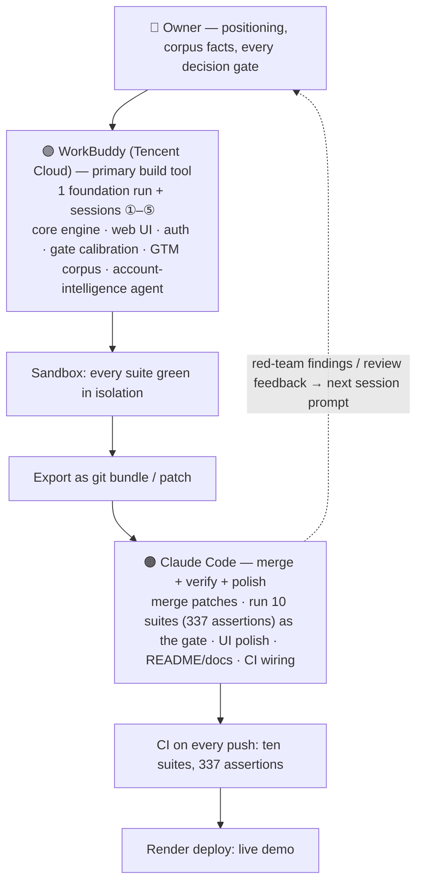

# AI Collaboration Record — how Meridian Pay Knowledge Brain was built

Built with **WorkBuddy (Tencent Cloud)** as the primary development tool, with Claude Code used for merging, verification and UI polish. This document is the written development-process description required by the Hackathon Handbook §7 (proof of product usage: chat screenshots, API call logs, or a written development-process description).

## WorkBuddy build sessions (primary development)

| Date | Session | What WorkBuddy built | Prompt / log |
|---|---|---|---|
| 2026-09-26 | Foundation run | Core `kb_qa.py`: Markdown ingestion & chunking, BM25 + TF-IDF hybrid retrieval, directory-level RBAC (admin / viewer), SQLite audit trail, 9 tests — all green in the sandbox | `docs/build-sessions/workbuddy试跑_知识库系统_对话记录.md` (full conversation) |
| 2026-10-08 | Session ① | `web_ui.py` (pure stdlib `http.server`) + `static/index.html` single-page chat UI; no new pip dependencies | `docs/build-sessions/会话①_prompt.md` |
| 2026-10-10 | Session ② | UI hardening: auth plumbing, audit drawer, preset-question chips | `docs/build-sessions/会话②_prompt.md` |
| 2026-10-11 | Session ③ | Token authentication (PBKDF2 + HMAC), relevance gate calibration (absolute score, 27 labelled samples), sales role, RBAC gold-standard upgrade | `docs/build-sessions/会话③_prompt.md` |
| 2026-10-12 | Session ④ | Meridian Pay brand, GTM corpus (8 docs: public/internal/gtm), 8-case RBAC gold standard, sub-question-level RBAC | `docs/build-sessions/会话④_prompt.md` |
| 2026-10-13 | Session ⑤ | `gtm_research` Account Intelligence agent: signal scorecard, ICP routing, discount tiers, compliance boundaries, first-touch email draft, human-decisions list | `docs/build-sessions/会话⑤_prompt.md` |

WorkBuddy chat screenshots from the build: `证据/workbuddy截图_01..12.png`.

Each session ran as one full prompt in WorkBuddy's sandbox; its patches were brought back to this repository, merged, and verified against the four test suites below.

## Claude Code (merge + verification + polish)

- Merged WorkBuddy sandbox patches into this repo (git history therefore carries a Claude co-author line on merge commits)
- Ran the four test suites (81 assertions: RBAC gold standard, relevance calibration, auth attack surface, web matrix) as the quality gate after every merge
- UI polish: Aspire purple-red brand system, planning block, designed no-context card
- Docs and README

**Test growth across the build:** 9 tests at the foundation run (9/26) → 337 assertions across ten suites incl. the 26-check red team suite, 8 fintech-role matrix cases, 5 data-freshness (resync) cases, the audit hash-chain suite (append-only triggers + SHA-256 tamper detection), the disclosure-gate suite (customer-present mode: external-context zero leak + zero miss) and the shield suite (need-to-know masking + prompt-injection scan + answer re-check, with paired assertions proving precision), the GTM scorecard suite (deterministic scoring: reproducible tier mapping, red-line precedence, missing-fact handling) and the GTM outreach suite (deterministic first-touch email: slot filling by tier/industry/strongest signal, red line produces no copy at all, no invented numbers) (10/15). CI runs all ten suites on every push.

## How the two agents divided the work

- **WorkBuddy** owns breadth and velocity: each session is one full prompt that builds a whole subsystem in its sandbox; the session prompt (persisted in `docs/build-sessions/`) doubles as the design document.
- **Claude Code** owns correctness and convergence: nothing lands on `main` without the ten-suite gate; UI polish and documentation keep the single source of truth coherent.
- **The owner** sits on every decision gate: positioning, corpus facts, scope cuts, and final submission — the agents propose, the human disposes.

High-res versions of this workflow (with per-session example annotations):
- [docs/multi-agent-workflow-1920x1080.png](multi-agent-workflow-1920x1080.png) (16:9)
- [docs/multi-agent-workflow-1080x1440.png](multi-agent-workflow-1080x1440.png) (portrait)

Promo card set (cover + P1–P5 explainer cards + architecture & workflow cards, XHS-optimised, link-free): [docs/promo-cards/](promo-cards/)

## Proof checklist (Handbook §7)

| Requirement | Status |
|---|---|
| Built on CodeBuddy or WorkBuddy | ✅ WorkBuddy — 1 foundation run + 5 build sessions above |
| Chat history ≥ 3 screenshots | ✅ 12 screenshots in `证据/` |
| Written development-process description | ✅ This document + session prompts + foundation conversation log |
