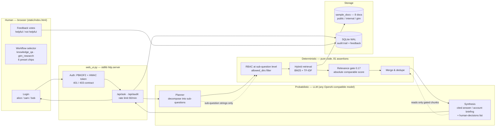

# Architecture — Meridian Pay Knowledge Brain

One engine, three trust zones. The LLM sits at the edges (plan, synthesise); deterministic code owns retrieval, access control and storage. The LLM has **no write path** to documents or the database, and never sees a chunk that has not already passed RBAC and the relevance gate.

## Pipeline

## Trust boundaries

| Zone | Components | Can | Cannot |
|---|---|---|---|
| **Probabilistic** | Planner LLM, synthesis LLM | Turn a question into sub-questions; turn gated chunks into text | Read documents that failed RBAC or the gate; write to the database; decide access |
| **Deterministic** | Auth, RBAC filter, retrieval, relevance gate, audit, policy tiers | Sole code path that touches documents and storage | — |
| **Human** | Browser (login, ask, workflow select, feedback) | Act as one of three roles with real credentials | Declare a role — roles come only from the server-issued token |

Two properties follow from this split:

1. **A decomposed query cannot fish out restricted documents.** RBAC is applied per sub-question *before* retrieval (pre-retrieval ACL filtering — the OWASP LLM08 recommended control). If a compound question touches an out-of-scope directory, that sub-question retrieves nothing and the answer is either synthesised from permitted chunks alone or returns a clean `no_context`.
2. **"Off-topic" is a measurement, not a feeling.** Relevance = BM25 score / query self-match ceiling, threshold 0.17 calibrated on 27 labelled samples (irrelevant ≤0.145, relevant ≥0.244). The gate is pure code and tested (21 cases).

## Components

| Component | File | Role |
|---|---|---|
| Ingestor | `kb_qa.py` | Markdown → chunks by heading with overlap; connector architecture: Markdown demonstrated, slots reserved for Confluence/Jira/Drive/Slack |
| Retriever | `kb_qa.py` | BM25 + TF-IDF, mixed CN/EN tokenisation (single char + bigram) |
| Relevance gate | `kb_qa.py` | Absolute comparable score, threshold 0.17 (env `KB_MIN_SCORE`) |
| RBAC | `kb_qa.py` | `User.role` → `allowed_dirs` (admin: all · sales: public+gtm · viewer: public), enforced per sub-question |
| Auth | `auth.py` | PBKDF2-HMAC-SHA256 (200k iters + salt), HMAC-signed tokens with jti revocation, constant-time compare, anti-enumeration |
| Audit + feedback | `kb_qa.py` | SQLite WAL; every Q&A logged (user, role, question, sources, mode, latency); vote loop |
| Agent engine | `kb_qa.py` | `WORKFLOWS` registry: `knowledge_qa`, `gtm_research` — plan/synthesis prompts define each agent |
| Web service | `web_ui.py` | Stdlib `http.server`; bearer-only endpoints; per-identity rate limiting |
| UI | `static/index.html` | Chat, workflow selector, chips, planning block, source badges, no-context card, audit drawer, feedback, briefing download |
| Evaluation | `test_*.py` | Four suites, 81 assertions: RBAC gold standard (leak=0 / recall-loss=0), gate calibration, auth attack surface, web matrix |

## Failure handling

- Transient LLM faults → automatic retry; no key configured → extractive fallback (answer from gated chunks)
- Below-gate or blocked retrieval → designed `no_context` card ("证据不足 · 已拒绝回答") — refuse, never fabricate
- Every briefing ends with a human-decisions list (discount sign-off 15%/30%, compliance review, email approval) — escalation is a designed output
